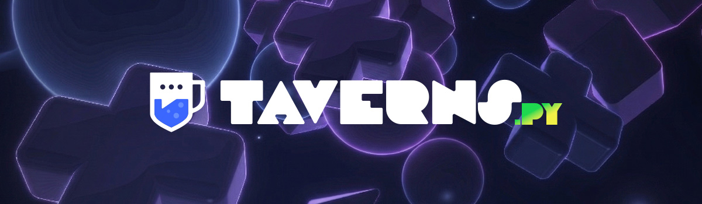

<p align="center">
  
</p>

# taverns.py

Python SDK for building Tavern bots on the [Taverns](https://tav.gg) platform.

## Installation

```bash
pip install taverns.py
# or from source:
pip install -e .
```

Requires Python 3.10+.

## Quick Start

```python
import os
from taverns import Client, Intents

client = Client(intents=Intents.MESSAGES | Intents.MESSAGE_CONTENT)

@client.event
async def on_ready():
    print(f"Logged in as {client.user.display_name}")

@client.event
async def on_message_create(message):
    if message.sender_id == client.user.id:
        return
    if message.content == "!ping":
        await client.send_message(message.tavern_id, message.channel_id, content="Pong!")

client.run(os.environ["BOT_TOKEN"])
```

## Slash Commands

```python
from taverns import Client, Intents, Interaction
from taverns.commands import command, option
from taverns.types import CommandOptionType

client = Client(intents=Intents.MESSAGES | Intents.INTERACTIONS)

@client.event
async def on_ready():
    await client.register_commands([
        command("ping", "Check latency"),
        command("greet", "Greet someone", options=[
            option("name", "Who to greet", CommandOptionType.STRING, required=True),
        ]),
    ])

@client.event
async def on_interaction_create(interaction: Interaction):
    if interaction.command_name == "ping":
        await interaction.reply("Pong!")
    elif interaction.command_name == "greet":
        name = interaction.get_option("name", "World")
        await interaction.reply(f"Hello, {name}!")

client.run(os.environ["BOT_TOKEN"])
```

### Deferred Responses

```python
@client.event
async def on_interaction_create(interaction: Interaction):
    if interaction.command_name == "slow":
        await interaction.defer_reply()      # Shows "thinking..." to the user
        result = await do_slow_work()
        await interaction.follow_up(f"Done: {result}")
```

### Ephemeral Responses

```python
await interaction.reply("Only you can see this", ephemeral=True)
```

## Webhook Verification

```python
import os
from taverns import verify_webhook_signature

WEBHOOK_SECRET = os.environ["WEBHOOK_SECRET"]  # an empty secret raises ValueError

is_valid = verify_webhook_signature(
    raw_body=request.get_data(),                          # the raw bytes, not parsed JSON
    signature=request.headers.get("X-Tavern-Signature"),
    secret=WEBHOOK_SECRET,
    timestamp=request.headers.get("X-Tavern-Timestamp"),
)
```

The signature covers the raw request body. Requests older than 5 minutes, judged by the `timestamp` inside
the signed body, are refused; change that with `max_age=` (seconds). A complete Flask receiver is in
[`examples/webhook_server.py`](examples/webhook_server.py).

## Intents

Control which events your bot receives:

```python
from taverns import Intents

# Specific intents
client = Client(intents=Intents.MESSAGES | Intents.INTERACTIONS)

# All non-privileged intents
client = Client(intents=Intents.DEFAULT)

# All intents (including privileged)
client = Client(intents=Intents.ALL)
```

Privileged intents (`MESSAGE_CONTENT`, `MEMBERS`) are self-serve for private bots.

## Direct Messages

A bot can message a person who is in a tavern where the bot is installed, as long as the person allows DMs from
bots (the default) or wrote to the bot, or used one of its commands, in the last 24 hours. People can block and
report bots, and the apps mark the DM as an app, not a person. Message people because they asked for it (a
command, a reminder they set), not to advertise.

The `DIRECT_MESSAGES` intent (`1 << 16`, in `DEFAULT`, not privileged) delivers what people send the bot. The
content is always included.

```python
from taverns import DMErrorCode, HTTPError, RateLimitError

@client.event
async def on_dm_message_create(message):
    if message.content == "help":
        await client.send_dm_message(message.channel_id, "Try /play in a tavern.", reply_to_id=message.id)

try:
    await client.send_dm(user_id, "Your reminder:", embeds=[embed])  # opens the DM once, then reuses it
except RateLimitError as e:
    print(e.scope, e.retry_after)  # a DM limit: not resent for you
except HTTPError as e:
    if e.code == DMErrorCode.CANNOT_DM_USER:
        ...  # they can't be messaged
```

Also: `create_dm(user_id)`, `send_dm_message(channel_id, content)`, `get_dm_channel(channel_id)`,
`get_dm_messages(channel_id, before=, limit=)`, `edit_dm_message(channel_id, message_id, content)`,
`delete_dm_message(channel_id, message_id)` on the client and on `client.rest`, and the `on_dm_message_update` and
`on_dm_message_delete` events. DMs have their own limits per person and per bot; see
[Direct Messages](https://tav.gg/developers/docs/dms) and [Rate Limits](https://tav.gg/developers/docs/rate-limits).

## Voice Halls

Bots can play audio in a tavern's voice halls, and hear them when the tavern allows it.

```bash
pip install "taverns.py[voice]"   # adds the livekit package
# and install ffmpeg (on your PATH, or set FFMPEG_PATH) to play files and URLs
```

```python
connection = await client.voice.join(voice_hall_id)  # tavern_id=... if the hall is not cached

await connection.play("music/intro.mp3")             # a file or an http(s) URL
await connection.play("https://example.com/radio.ogg", volume=0.5)
await connection.play_pcm(pcm_bytes)                 # raw 48 kHz signed 16-bit LE, stereo (or channels=1)

connection.pause()
connection.resume()
connection.stop()
await connection.leave()

@connection.on("disconnected")
def on_left(reason):
    print("left voice:", reason)
```

What the bot needs in that hall: **Connect** plus **Speak** to play, **Connect** plus **Listen in voice halls** to hear
(see below). One of Speak or Listen is enough to join: a bot with Connect and Listen but no Speak joins
**listen-only**. `connection.can_speak` says whether it may play; on a listen-only connection `play()` and
`play_pcm()` raise `TavernError` and nothing is published (the audio track is published on the first play).

Speak and Listen follow the tavern live: losing Speak stops what is playing and the bot stays to listen (if it may);
getting Speak back lets the next play work again. Watch them with `@connection.on("can_speak")` and
`@connection.on("listening")`.

The bot holds one voice connection per tavern (joining another hall of it moves the bot) and renews its connection
automatically. Members see it in the hall with a bot badge; moderators can disconnect it. Its audio is not end-to-end
encrypted, and the apps show that while a bot is in a hall.

### Hearing a hall

A bot hears a voice hall only when it requests `LISTEN_VOICE` ("Listen in voice halls") and the tavern grants it.
It is never granted by default, and Administrator does not include it. Members then see a "listening" marker on the
bot. A bot that only needs to hear (a recorder, a transcriber) does not need Speak.

```python
@connection.on("audio")
def on_audio(frame):
    # frame.user_id, frame.is_bot, frame.source ("microphone" or "screen_share_audio")
    # frame.pcm: bytes, 48 kHz mono s16le, 20 ms
    ...

@connection.on("speaking")
def on_speaking(event):
    print(event.user_id, "started" if event.speaking else "stopped")
```

If your bot records, transcribes or otherwise processes what people say, say so in your bot's description and
privacy policy, and make sure the people in the hall know.

## REST Client

For direct API access:

```python
# Available after login
channels = await client.rest.get_channels(tavern_id)
members = await client.rest.get_members(tavern_id)
messages = await client.rest.get_messages(tavern_id, channel_id, limit=50)
```

IDs passed to the REST helpers are escaped, so an ID taken from user input (a command option, message text)
cannot point a request at another route. `client.rest.request(method, path)` sends the path you give it
unchanged.

A request answered with 429 is sent again after the wait the API asks for. After a server error (5xx) or a
dropped connection, only GET and PUT requests are sent again; POST, PATCH and DELETE requests are sent again
only when the connection could not be opened at all, so a message, a kick or a ban is never sent twice. A
request that still fails raises `HTTPError` (or the aiohttp error); `HTTPError.code` holds the API's error code
when it sent one. A request over a direct message limit is not sent again: it raises `RateLimitError` at once,
with `scope` and `retry_after`.

## Connections and Logging

- The bot token is sent only over `https://` and `wss://`. For a local test server, pass
  `allow_insecure=True` to `Client` to accept `http://` and `ws://` URLs.
- If the gateway refuses the token (revoked, regenerated, or the bot was disabled), the client stops
  reconnecting and raises `AuthenticationError`.
- The SDK logs under `taverns.*`. At DEBUG level, `taverns.gateway` logs every gateway frame (message
  content and user data) and `taverns.gateway.ws` logs the WebSocket handshake. The token is replaced with
  `<redacted>` in both, but keep DEBUG logs out of shared places.

## Links

- [PyPI package](https://pypi.org/project/taverns.py/)
- [API Documentation](https://tav.gg/developers/docs)
- [Developer Portal](https://tav.gg/developers/home)
- [taverns.js](https://github.com/Tav-gg/taverns.js) (Node.js SDK)
